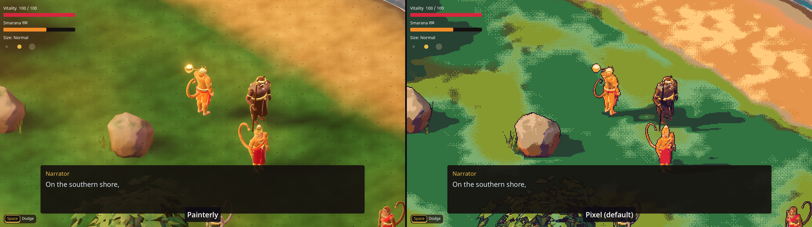
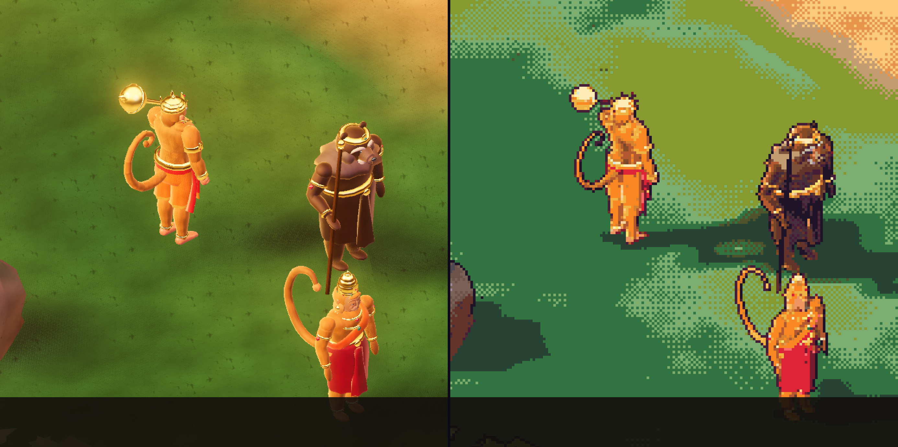
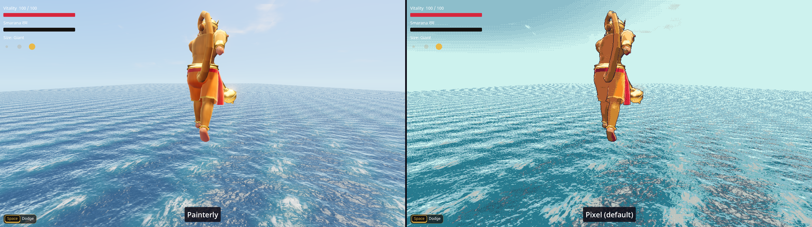
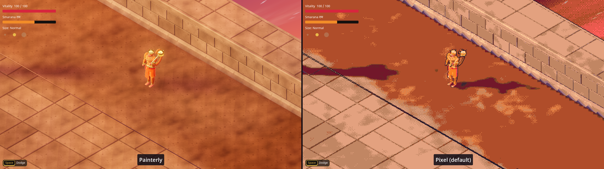
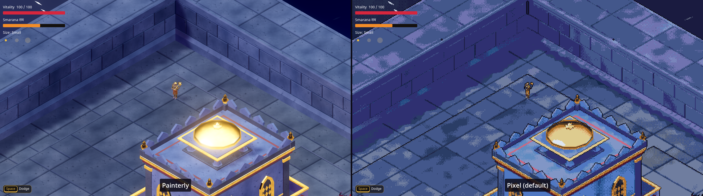
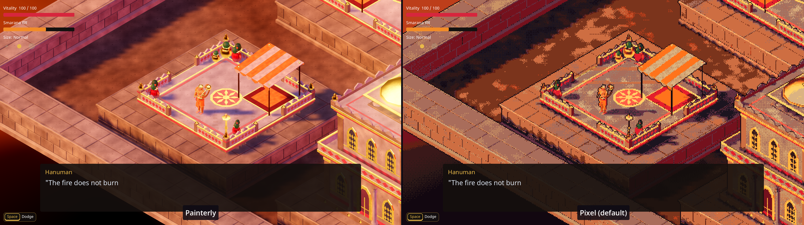
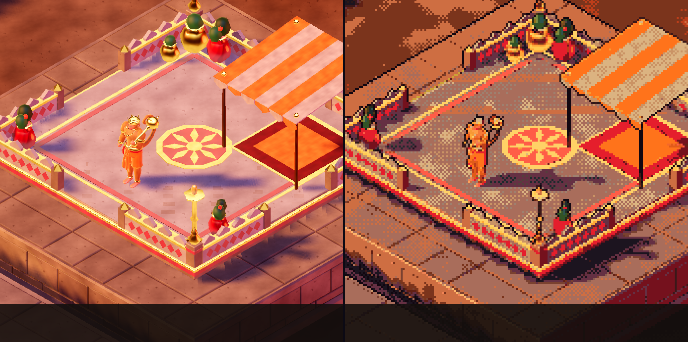
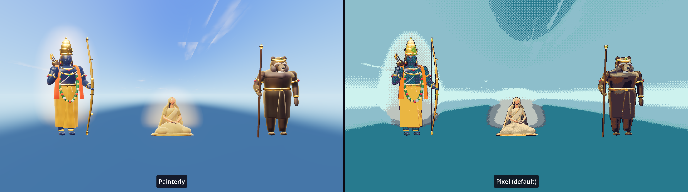
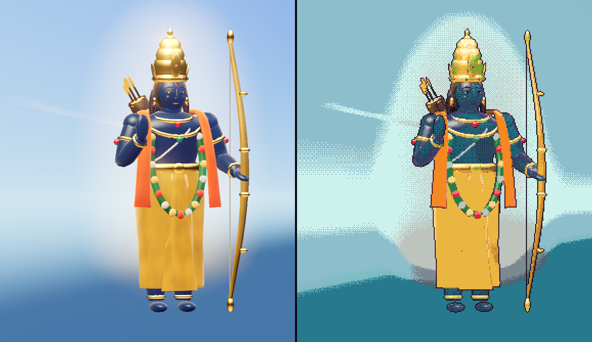

# Pixel style v2 (default) next to Painterly

The same game frames in both styles (left Painterly, right Pixel); switch in Settings → Style.
Rendered with `dev/preview/compare_styles.gd`. Each mood has its own limited palette.

